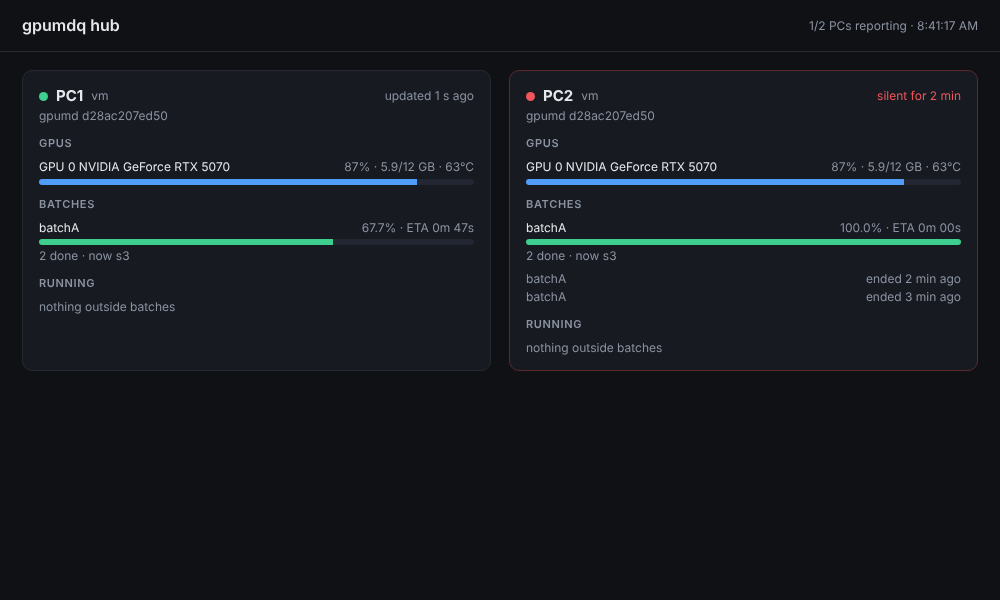
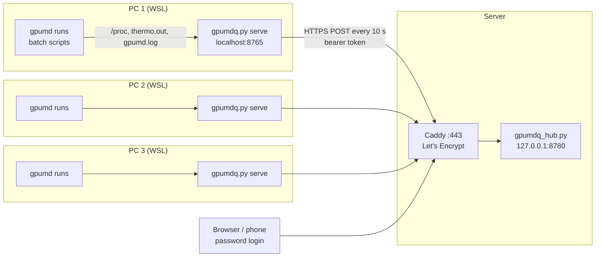
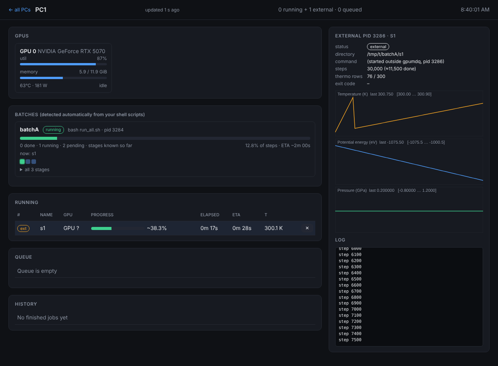

# gpumdclouddashboard: GPUMD queue, batch monitor and multi-PC cloud dashboard

**gpumdq** is a small queue and live monitor for [GPUMD](https://github.com/brucefan1983/GPUMD) molecular-dynamics
runs. **gpumdq_hub** is a matching web hub that shows several GPU computers, in different places, on one HTTPS page.

* Standard-library Python only: no pip installs, no database server, no web framework.
* Works with your existing batch shell scripts. It finds running `gpumd` processes and the script that started
  them, and reports per-stage progress and ETA without any changes to the scripts.
* Each PC stays in control of its own jobs. The hub is read-only, and the PCs only make outgoing HTTPS
  requests, so they need no open ports, VPN or fixed IP.



---

## Contents
1. [How it fits together](#how-it-fits-together)
2. [Repository layout](#repository-layout)
3. [Requirements](#requirements)
4. [Quick start on one PC (Windows + WSL)](#quick-start-on-one-pc-windows--wsl)
5. [Running work: queue mode and script mode](#running-work-queue-mode-and-script-mode)
6. [Connecting PCs to the cloud hub](#connecting-pcs-to-the-cloud-hub)
7. [Setting up the hub server](#setting-up-the-hub-server)
8. [Command and configuration reference](#command-and-configuration-reference)
9. [How detection and progress work](#how-detection-and-progress-work)
10. [Security](#security)
11. [Troubleshooting](#troubleshooting)
12. [Guide for AI agents organising batches](#guide-for-ai-agents-organising-batches)

---

## How it fits together



* **`gpumdq.py serve`** runs on every GPU computer, inside WSL when GPUMD runs in WSL. It schedules queued jobs,
  detects runs started by other means, and serves a local dashboard on http://localhost:8765.
* With a `hub.env` file present, it also pushes a compressed status snapshot to the hub every 10 s.
* **`gpumdq_hub.py`** stores the latest snapshot per PC and serves the overview page. Clicking a PC opens a
  read-only copy of that PC's own dashboard, including live plots and log tails.
* When someone opens a plot on the hub, the hub asks for it in its reply to the next push. The PC sends the data
  straight away, so the hub never connects to the PCs.

## Repository layout

| path | purpose |
|---|---|
| `gpumdq.py` | per-PC queue, process detection, batch tracking, local dashboard, hub push agent |
| `gpumdq_hub.py` | hub server: token-authenticated push endpoint, password-protected overview, per-PC pages, ntfy alerts |
| `start_gpumdq.bat` | Windows double-click launcher; runs `start_wsl.sh` inside WSL and opens the dashboard |
| `start_wsl.sh` | WSL launcher: reads `hub.env`, sets the GPUMD binary and CUDA library path, starts `gpumdq.py serve` |
| `start_gpumdq.ps1` | launcher for GPUMD built natively on Windows (`gpumd.exe`, needs `psutil`) |
| `hub.env.example` | template for the per-PC settings file `hub.env` (hub URL, token, name, GPUMD path) |
| `deploy/Caddyfile` | HTTPS reverse proxy for the hub (IP-address certificate or domain) |
| `deploy/gpumdq-hub.service` | systemd unit for the hub |
| `docs/SERVER_SETUP.md` | step-by-step server installation and troubleshooting |
| `docs/AGENT_GUIDE_batch_runs.md` | rules for humans and AI agents preparing batch computations |
| `examples/run_all.sh` | minimal batch driver that follows the tracking rules |
| `examples/example.plan` | plan-file format for stages created during a batch |
| `plans/` | put your own `*.plan` files here (git-ignored) |

## Requirements

**GPU computers:** Python ≥ 3.8 and `nvidia-smi` on PATH. Under WSL, `start_wsl.sh` adds `/usr/lib/wsl/lib`.
gpumdq must run in the **same** environment as gpumd: the same WSL distro, or native Windows for `gpumd.exe`.
A program on the Windows side cannot see processes inside WSL.

**Hub server:** Linux with Python ≥ 3.8, a public IP and ports 80/443 open, plus Caddy ≥ 2.11.
A domain name is optional.

## Quick start on one PC (Windows + WSL)

```bash
# inside WSL
git clone https://github.com/oskpan/gpumdclouddashboard.git /mnt/c/Users/<you>/Documents/gpumdq
cd /mnt/c/Users/<you>/Documents/gpumdq
cp hub.env.example hub.env      # optional now; needed only for the hub
nano hub.env                    # at least set GPUMD_BIN if gpumd is not on PATH
```
Double-click **`start_gpumdq.bat`** in Windows Explorer, or run `bash start_wsl.sh` in WSL.
Then open http://localhost:8765. Closing the window stops the dashboard but not the GPUMD runs. When gpumdq
starts again it re-attaches to everything that is still running.

Generic Linux without WSL:
```bash
python3 gpumdq.py serve --cmd /path/to/GPUMD/src/gpumd        # --gpus 0,1 to restrict GPUs
```

## Running work: queue mode and script mode

### Queue mode: independent jobs
Each directory contains a complete GPUMD input set (`run.in`, `model.xyz`, the potential, …).
```bash
python3 gpumdq.py submit runs/T300 runs/T400 runs/T500
python3 gpumdq.py submit runs/urgent -p 10       # higher priority runs first
python3 gpumdq.py submit runs/big -g 1           # pin to GPU 1
python3 gpumdq.py list                           # progress and ETA
```
gpumdq runs one job per GPU and sets `CUDA_VISIBLE_DEVICES`. It writes the output to `gpumdq.log` in the job
folder and gives exact progress. When a job finishes or fails, the hub can alert your phone.

### Script mode: dependent stages run by your own driver
Start your driver as a script file in the study folder, for example `nohup bash run_all.sh > run_all.out 2>&1 &`.
gpumdq then shows a **Batch** card with every stage, a done/running/partial/ready/planned status for each, the
current stage, the overall progress weighted by MD steps, and an ETA. Clicking any stage shows its plots and log.



What the driver must do to be tracked (details and a template are in
[docs/AGENT_GUIDE_batch_runs.md](docs/AGENT_GUIDE_batch_runs.md)):
1. The script lives in the study's top folder, and the stage folders containing `run.in` are below it.
2. Start it as a file (`bash run_all.sh` or `./run_all.sh`), not as a loop pasted into a terminal.
3. Run gpumd inside each stage folder, with output in that folder's `gpumd.log`:
   `(cd "$d" && gpumd > gpumd.log 2>&1)`.
4. Use one fresh folder per run, put `dump_thermo` before every `run`, and `export CUDA_VISIBLE_DEVICES=…`.
5. If stage folders are created during the batch, add a plan file so they count toward the ETA:
   `gpumdq_plan.txt` in the batch folder, or `plans/<name>.plan` with a `root:` line.
   See [examples/example.plan](examples/example.plan).

While a batch script is alive, its GPU stays reserved: queued jobs don't start on it, including during the
60 s after each stage. Don't mix queue mode and a driver on the same GPU.

## Connecting PCs to the cloud hub

On each PC, after the server is set up and the PC has a token (see below):
```bash
cd /path/to/gpumdq
cp hub.env.example hub.env && chmod 600 hub.env && nano hub.env
```
```ini
GPUMDQ_HUB=https://YOUR.SERVER.IP.OR.DOMAIN
GPUMDQ_HUB_TOKEN=<token printed by add-host for this PC>
GPUMDQ_NAME=PC1
GPUMD_BIN=/home/<user>/GPUMD/src/gpumd      # the binary your runs use
```
Restart gpumdq with `start_gpumdq.bat`. This doesn't touch running jobs. `gpumdq.py` also reads `hub.env` from its own folder,
so a plain `python3 gpumdq.py serve` reports to the hub too. The console should print:
```
Hub   : reporting to https://... as 'PC1'
gpumdq: pushing status as 'PC1' to https://... every 10 s
```
The PC's card appears on the hub within about 10 s. If the hub can't be reached, gpumdq says so once, keeps
retrying, and local monitoring is unaffected. Without `hub.env`, nothing is sent anywhere.

The hub card shows the SHA-256 of each PC's `GPUMD_BIN` and highlights PCs that use a different build. This is a
quick check that all computers produce comparable results.

## Setting up the hub server

Short version, on Linux, run as root (full guide with troubleshooting: [docs/SERVER_SETUP.md](docs/SERVER_SETUP.md)):
```bash
useradd --system --home /var/lib/gpumdq-hub --create-home --shell /usr/sbin/nologin gpumdq
mkdir -p /opt/gpumdq && cp gpumdq.py gpumdq_hub.py /opt/gpumdq/
H="runuser -u gpumdq -- env GPUMDQ_HUB_HOME=/var/lib/gpumdq-hub python3 /opt/gpumdq/gpumdq_hub.py"
$H set-password <you>          # web login
$H add-host PC1                # prints PC1's token once (repeat for PC2, PC3, ...)
cp deploy/gpumdq-hub.service /etc/systemd/system/ && systemctl daemon-reload && systemctl enable --now gpumdq-hub
# install Caddy >= 2.11, put your IP (or domain) into deploy/Caddyfile, copy it to /etc/caddy/Caddyfile
systemctl restart caddy && curl https://YOUR.SERVER.IP/healthz        # {"ok": true}
```
For a quick test on one machine:
`python3 gpumdq_hub.py add-host test`, then `python3 gpumdq_hub.py serve --no-auth`, then
`python3 gpumdq.py serve --hub http://127.0.0.1:8780 --hub-token <token> --name test`, then open
http://127.0.0.1:8780.

**Phone alerts** (optional): start the hub with `--ntfy https://ntfy.sh/<long-random-topic>` and subscribe to
that topic in the ntfy app. You get alerts when a queued job finishes or fails, when a batch script ends (with
the number of incomplete stages), and when a PC stops reporting and when it comes back.

## Command and configuration reference

### `gpumdq.py`
| command | what it does |
|---|---|
| `serve` | scheduler, process detection, dashboard on `--host 127.0.0.1 --port 8765` |
| `submit DIR...` | queue directories (`-p` priority, `-g` GPU, `-n` name, `--cmd` per-job command) |
| `list [-a]` | jobs and batches with progress and ETA (`-a` includes history) |
| `cancel ID...` | drop a queued job or kill a running one |
| `top ID` / `priority ID N` | reorder the queue |
| `requeue ID...` / `delete ID...` | rerun or forget finished jobs |

Client commands take `--server host:port` (default `127.0.0.1:8765`).

`serve` options: `--gpus 0,1`, `--cmd "<gpumd command>"`, `--poll 2`, `--hub URL`, `--hub-token T`,
`--name PC1`, `--push-every 10`. Prefer `hub.env` for the hub settings, because command-line arguments are
visible to other users in `ps`.

| environment variable | meaning |
|---|---|
| `GPUMDQ_HOME` | queue database folder (default `~/.gpumdq`) |
| `GPUMD_CMD` | command used to start gpumd (set by `start_wsl.sh` from `GPUMD_BIN` / `GPUMD_LIB`) |
| `GPUMD_BIN`, `GPUMD_LIB` | GPUMD binary and its CUDA library folder (used by `start_wsl.sh`) |
| `GPUMDQ_HUB`, `GPUMDQ_HUB_TOKEN`, `GPUMDQ_NAME`, `GPUMDQ_PUSH_EVERY` | hub connection (normally in `hub.env`) |

### `gpumdq_hub.py`
| command | what it does |
|---|---|
| `serve [--host 127.0.0.1] [--port 8780] [--ntfy URL] [--stale S] [--no-auth]` | run the hub |
| `add-host NAME` / `remove-host NAME` | create or replace, or revoke, a PC token; takes effect without restart |
| `set-password USER` | create or change a web login |
| `list` | registered PCs and logins |

| environment variable | meaning |
|---|---|
| `GPUMDQ_HUB_HOME` | config and state folder (default `~/.gpumdq_hub`) |
| `GPUMDQ_NTFY` | ntfy topic URL for alerts |

Hub endpoints: `POST /api/push` (PC, bearer token); `GET /`, `/api/hosts`, `/h/<PC>/`,
`/h/<PC>/api/...` (viewer, Basic auth); and `GET /healthz`.

## How detection and progress work

* **Queued jobs** are stored in SQLite at `~/.gpumdq/jobs.db`. The highest-priority, then oldest, job starts
  when a GPU is free. Jobs run detached, so stopping the server doesn't kill them, and they are re-attached on
  restart.
* **External runs.** Every 2 s gpumdq lists the processes named `gpumd` (or named like the binary in
  `GPUMD_CMD`) that it didn't start itself. For each one it reads:
  * the working directory, which is the run folder;
  * the GPU, from nvidia-smi or the process's `CUDA_VISIBLE_DEVICES`;
  * its parent processes, up to the outermost `bash something.sh` or `python something.py`.

  That script is the **batch**, and the folder the script is in is the batch root.
* **Stages** are the subfolders of the batch root that contain `run.in`, plus any listed in a plan file:

  | status | when |
  |---|---|
  | running | a gpumd process is working in that folder |
  | done | `gpumd.log` tail contains `Finished running GPUMD`, or `DONE`, `.done` or `COMPLETED.json` exists |
  | partial | `gpumd.log` exists without the finish line |
  | ready | `run.in` exists, not started |
  | planned | only listed in a plan file |

* **Progress** is the number of rows in `thermo.out` divided by the expected rows, which is the sum over `run`
  blocks of steps ÷ `dump_thermo`. Batch progress is weighted by MD steps. The ETA comes from the current
  stage's speed.
* **Hub traffic** is about 0.6 kB (gzip) per push without plots, and 2–3 kB with them. Plot data (≤ 300 points)
  and the last 60 log lines are sent for running items every 60 s, and on demand when a viewer opens an item.

## Security

* `hub.env` holds the PC's token and is **git-ignored**. Never commit it or put a token in a script.
* The hub stores only the SHA-256 of each token and PBKDF2 hashes of the passwords (`hub.json`, mode 600).
* The hub listens on 127.0.0.1 behind Caddy (HTTPS). The token and the password travel only in request headers
  over TLS. Plain-http hub URLs other than localhost produce a warning.
* The hub is read-only: it cannot start, cancel or kill anything, and the per-PC pages hide the queue controls.
* What leaves a PC: GPU stats, job and batch lists with folder paths, progress, ETA, the last T/U values, small
  thermo series and log tails. No input or output files are uploaded.
* The local dashboard has no login, so keep `--host 127.0.0.1` unless the network is trusted.

## Troubleshooting

| symptom | cause / fix |
|---|---|
| run shows as **ext** but no batch card | the driver isn't started as a script file in the study folder, or it exited; see the agent guide |
| progress `?` | a `run` block in `run.in` has no `dump_thermo` before it |
| progress jumps to ~100 % | `thermo.out` contains rows from an earlier run in the same folder; use a fresh folder |
| PC missing or "not reporting" on the hub | console says `not reporting to a hub`: `hub.env` is missing next to gpumdq.py or still the template. Fix it and restart gpumdq (older versions only read hub.env when started through start_wsl.sh) |
| `cannot push to hub … 403` | wrong token: run `add-host NAME` again on the server and update `hub.env` |
| `cannot push … SSL` / `tlsv1 alert internal error` | `default_sni` is missing in the Caddyfile (IP certificates); see docs/SERVER_SETUP.md |
| hub card red "silent for …" | PC asleep or offline, network down, or gpumdq closed |
| a plot on the hub says "the PC did not answer in time" | the PC is offline, or runs an older gpumdq.py than the hub |
| WSL: GPU shows `?` | nvidia-smi under WSL cannot map processes to GPUs; set `CUDA_VISIBLE_DEVICES` in the driver |

## Guide for AI agents organising batches

[docs/AGENT_GUIDE_batch_runs.md](docs/AGENT_GUIDE_batch_runs.md) is written as instructions for agents, and
people, who prepare GPUMD batch computations. It covers when to use the queue and when to use a driver script,
the twelve tracking rules, a restart-safe driver template, the plan-file format, and how to verify tracking
after launch. Point your agent to it when asking for a new computation package.

---

Older GPUMD versions that read the input file from stdin: `--cmd "gpumd < input.txt"`.
